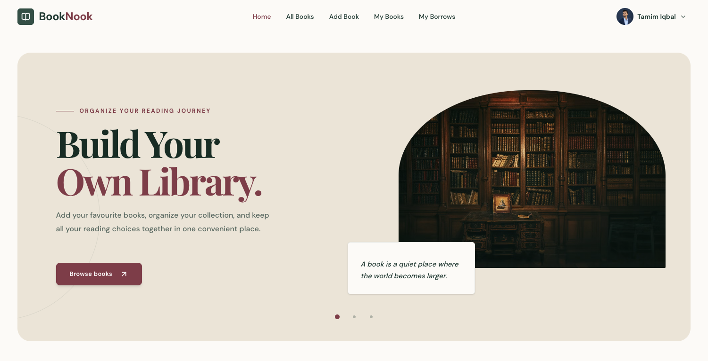
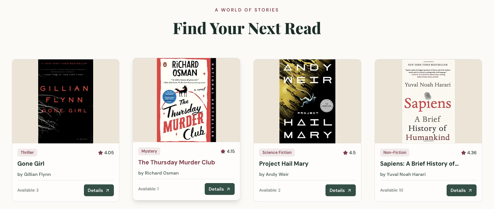
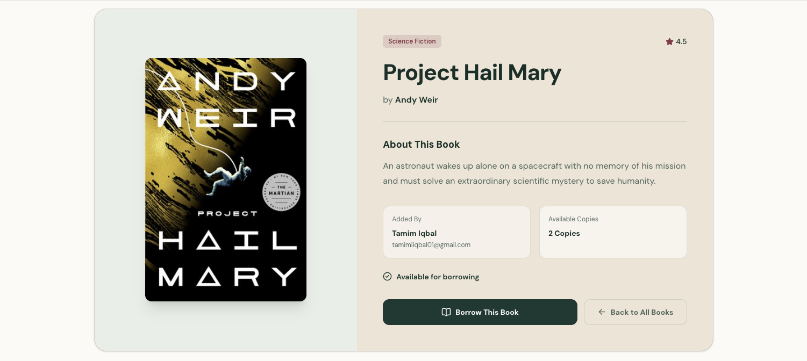
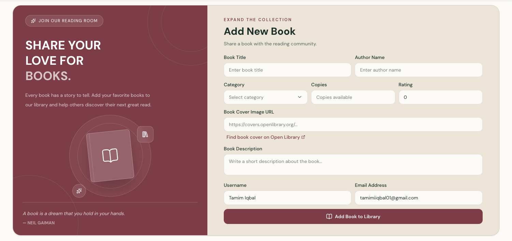
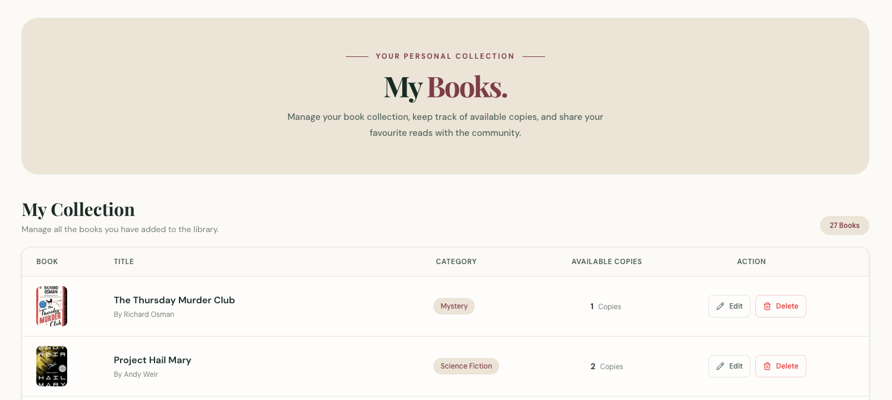
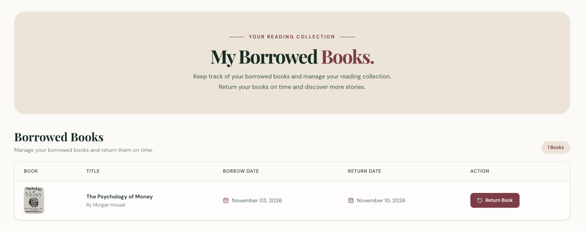
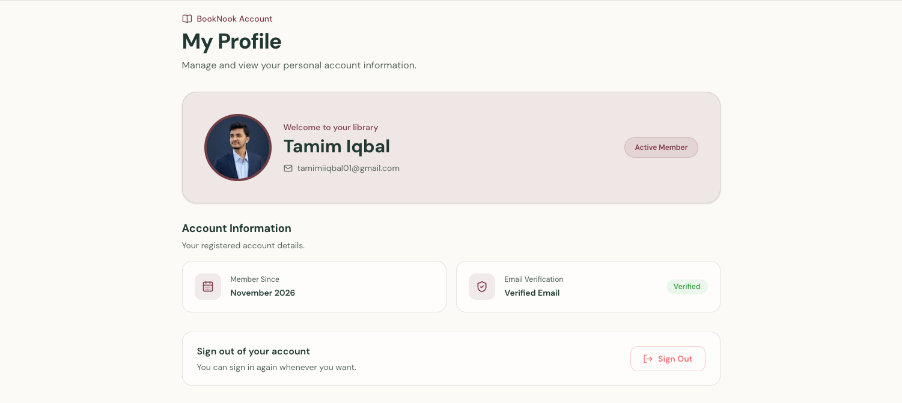

# BookNook Client

BookNook is a library and book-borrowing web application built with Next.js. Users can discover books, view details, borrow and return books, add or edit listings, and manage their personal library.

## Screenshots









## Tech Stack

<p>
  
  
  
  
  
  
  
</p>

## Prerequisites

- Node.js and npm
- A running BookNook backend API
- MongoDB for Better Auth
- Google OAuth credentials if Google sign-in is enabled

## Getting Started

Install dependencies:

```bash
npm install
```

Create `.env.local` in the project root:

```env
NEXT_PUBLIC_BACKEND_API_URL=http://localhost:5001
BETTER_AUTH_URL=http://localhost:3000
MONGODB_URI=your-mongodb-connection-string
BETTER_AUTH_GOOGLE_CLIENT_ID=your-google-client-id
BETTER_AUTH_GOOGLE_CLIENT_SECRET=your-google-client-secret
```

Start the development server:

```bash
npm run dev
```

Open [http://localhost:3000](http://localhost:3000).

## Scripts

```bash
npm run dev       # Start the development server
npm run lint      # Run ESLint
npm run build     # Create a production build
npm run start     # Serve the production build
```

This repository does not currently include an automated test suite.

## Application Structure

- `src/app/` contains App Router routes, layouts, loading states, and error boundaries.
- `src/app/components/home/` contains the shared home-page shell, including navigation, hero content, and footer.
- `src/app/components/books/` contains reusable book cards and book actions such as borrowing, editing, and deleting.
- `src/app/context/AuthContext.tsx` provides the current Better Auth session to client components.
- `src/lib/` contains Better Auth setup and shared utilities.
- `src/types/book.ts` defines the shared `Book` data contract.
- `src/proxy.ts` protects authenticated routes and preserves the requested callback URL when redirecting to sign-in.

## Main Routes

| Route | Purpose |
| --- | --- |
| `/` | Home page with hero content and latest books |
| `/books` | Latest books collection |
| `/all-books` | Full book collection |
| `/book-details/[id]` | Book details and borrowing |
| `/add-book` | Add a book for authenticated users |
| `/my-books` | Manage books added by the signed-in user |
| `/my-borrows` | View and return borrowed books |
| `/profile` | Manage the user profile |
| `/sign-in` | Sign in with email/password or Google |
| `/sign-up` | Create an account with email/password or Google |

## Backend Integration

Book data and borrowing operations are handled by the separate backend configured through `NEXT_PUBLIC_BACKEND_API_URL`. The client uses endpoints for latest books, the complete collection, book details, adding and editing books, borrowing and returning books, and user-specific book lists.

Public collection pages fetch data in server components. Interactive operations and session-dependent pages use client components with Better Auth session state.

The backend repository is available at [BookNook-Server](https://github.com/Tamiim-Iqbal/BookNook-Server).

## Deployment

Build the application and start the production server:

```bash
npm run build
npm run start
```

Set all required environment variables in the deployment platform and make sure the backend API and MongoDB are reachable from the deployed application.